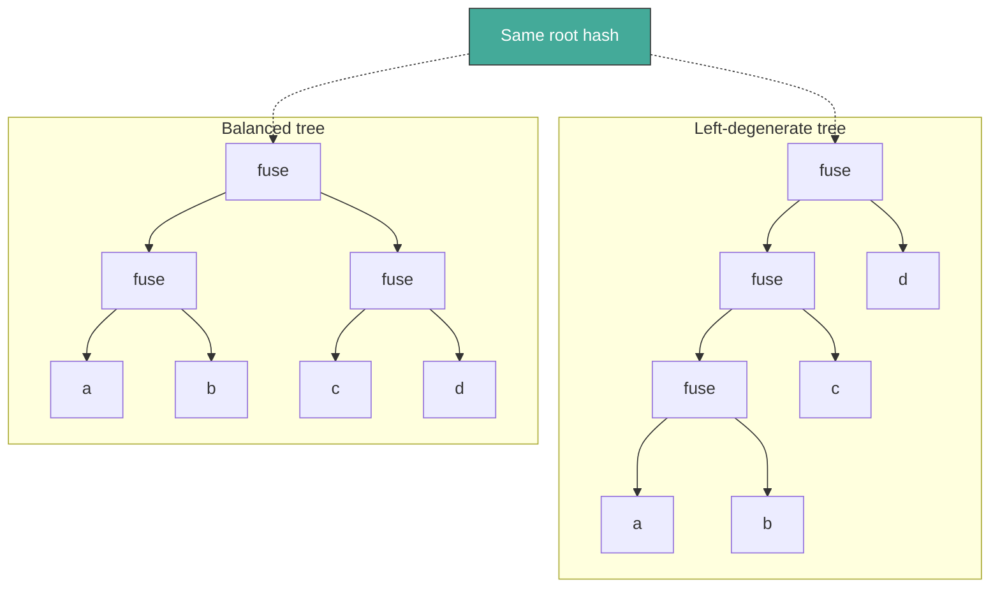
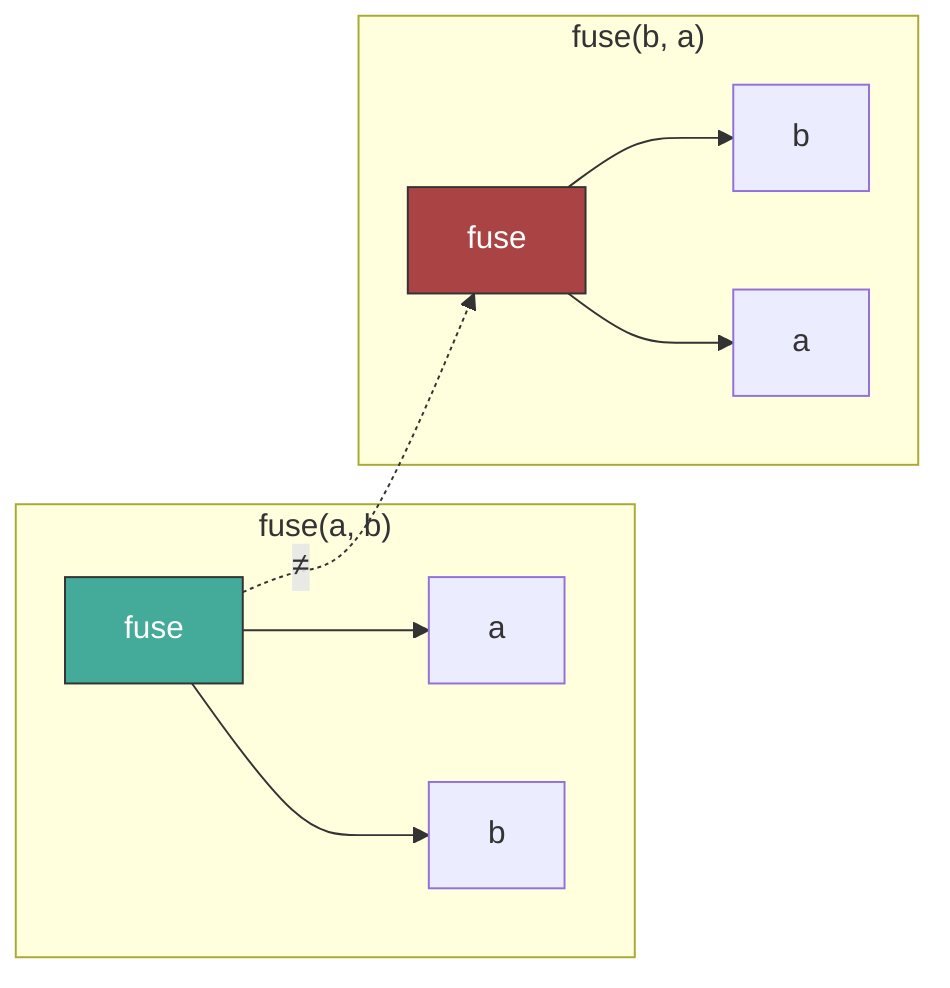

# Chapter 2: Hash Fusion

Writing an application? Start at [The Dacite way](../the-dacite-way.md).
This chapter is how content hashes are formed.

Chapter 1 introduced **content stores** — an immutable map from content
hashes to serialized values. Every node in that map is keyed by its hash.
This chapter defines how those hashes are formed.

Everything in Dacite's composite structures is built on a single
operation: **fuse**. It combines two *states* into a new state by
multiplying 2×2 matrices over a prime field. No SHA-256 at runtime, no hash
function calls in the critical path: eight multiplications of 127-bit
numbers and four reductions.

The idea originates from an HP Labs white paper on using matrix
multiplication to combine hashes associatively:

> Haber, S. et al. (2017). *Efficient and Secure Hash-Based Timestamps.*
> HPE-2017-08. https://www.labs.hpe.com/techreports/2017/HPE-2017-08.pdf

Matrix multiplication is associative but not commutative — exactly the
properties needed for tree-shape-independent hashing. Dacite's first fuse
was a 4×4 unitriangular matrix over 64-bit cells. Its group is nilpotent,
which made collisions come in families (issue #14: for any `a`, `b`,
`x`, `y`, `z`, the sequences `x a b y b a z` and `x b a y a b z` fused to
the same hash). The fuse is now a product in **SL(2, F_p)**, the 2×2
matrices with determinant 1 over the field of a fixed 127-bit prime. The
design, the prime and the tradeoffs are in
[docs/design/fuse-sl2.md](../../design/fuse-sl2.md); this chapter is the
model.

This chapter introduces fuse, its algebraic properties, and how it
turns raw bytes into content addresses. Chapter 3 applies these ideas to
the value model: scalars, plus the vectors, strings, blobs, maps, and
sets built on them.

## 2.1 States and Refs

Two kinds of value appear in this chapter:

- A **state** is a 2×2 matrix `[a b c d]` over F_p with `a·d − b·c = 1`
  (the group SL(2, F_p)), where

  ```
  p = 87078471178590763933909596057503143987        (127 bits)
  ```

  A state is 64 bytes: four cells of 16 big-endian bytes. Fuse works on
  states, and a collection's measure keeps one in full.
- A **ref** (a *hash*, the key a store files a node under) is the 32-byte
  **digest** of a state, four 64-bit words in big-endian word order:

  ```
  ref = [w0, w1, w2, w3]
  ```

  Stores, the wire and the HAMT all handle refs, so they are 256 bits, as
  before. Word `w0` is used first for HAMT navigation.

The digest packs the four cells as one integer
`N = a + b·2^127 + c·2^254 + d·2^381` and folds it:
`digest = (N mod 2^256) xor (N >> 252)`. Every digest bit then depends on
at least one input bit that is uniform over F_p. A digest is a pure
function of a state, and a value's ref is made only this way.

## 2.2 The Fuse Operation

Fuse takes two states and produces a third, by matrix product:

```
Input:  x = [a b]   y = [e f]
            [c d]       [g h]

Output: x·y = [a·e + b·g   a·f + b·h]   (every cell mod p)
              [c·e + d·g   c·f + d·h]
```

Eight multiplications, four additions and four reductions mod p. The
product of two determinant-1 matrices has determinant 1, so fuse never
leaves the group.

### Properties

These properties are not incidental — the entire system depends on them:

- **Associative** — `fuse(a, fuse(b, c)) = fuse(fuse(a, b), c)`.
  This means tree shape doesn't affect the hash. A balanced tree and
  a left-degenerate tree over the same leaf sequence produce the same
  root hash.
- **Non-commutative** — `fuse(a, b) ≠ fuse(b, a)` (for a ≠ b).
  Order matters. `[x, y]` and `[y, x]` have different hashes.
- **Identity** — the identity matrix `[1 0 0 1]` is a two-sided identity:
  `fuse(a, I) = fuse(I, a) = a`. Empty sequences hash to the identity.
- **No short cycles** — repeating one element, `a^n`, returns to the
  identity only when `n` is a multiple of the order of `a`, and every
  generator Dacite uses has order at least 2^119 (§2.7).
- **Fast enough** — no hash function calls, just integer arithmetic. This
  matters when every node in a tree computes a fuse on construction.

### Why Associativity Matters

Associativity is the foundation of structural sharing. Consider a
sequence `[a, b, c, d]`. Its hash is:

```
fuse(fuse(fuse(a, b), c), d)
```

But because fuse is associative, any parenthesization gives the same
result:

```
fuse(fuse(a, b), fuse(c, d))    — balanced tree
fuse(a, fuse(b, fuse(c, d)))    — right-degenerate tree
```

This means two stores can organize the same data differently (different
tree shapes for performance) and still agree on the root hash.



Different tree shapes, same root hash. This is what makes finger trees
possible — internal rebalancing never changes the identity of the
sequence.

### Why Non-Commutativity Matters

If fuse were commutative, `[a, b]` and `[b, a]` would hash the same.
Sequences would be indistinguishable from sets. Order-sensitive data
structures (vectors, strings) require that `fuse(a, b) ≠ fuse(b, a)`.



Order matters: `[a, b]` and `[b, a]` produce different hashes.

## 2.3 Group Structure

Fuse forms a **group**: SL(2, F_p). Every state has a unique inverse, the
adjugate, which costs no multiplication:

```
inv([a b c d]) = [d  -b  -c  a]        (cells mod p)
```

Such that `fuse(inv(x), x) = fuse(x, inv(x)) = I`.

### Unfuse

Given `fused = fuse(a, b)`, if you know `b`, you can recover `a`:

```
unfuse(fused, b) = fuse(fused, inv(b)) = a
```

Strip from the left: `fuse(inv(a), fused) = b`.

### What the Group Enables

- **Cross-type equality** — strip a type state to compare the underlying
  content (see Chapter 3, Cross-Type Equality). This works on states, not
  on refs: a ref is a digest and cannot be inverted.
- **Hash recovery** — recover one component of a fused pair when the
  other is known.
- **Incremental re-hashing** — update a fused chain without recomputing
  from scratch. Replace an element by unfusing the old and fusing the new.

## 2.4 The Byte Generators

Dacite doesn't hash bytes directly with fuse. Instead, it uses a
precomputed table mapping each byte value (0–255) to a generator, a state:

```
byte_state: byte → State    (256 entries)
```

The table is derived from SHA-256 once, at build time, by a tool that
keeps only matrices of large order (§2.7), and is shipped as data
(`dacite.sl2-table`, 64 bytes a row). SHA-256 is never used at runtime. An
independent Python script (`fixtures/fuse-sl2/reference.py`) re-derives the
same table from the seeds.

### Hashing Bytes and Strings

All data hashing reduces to table lookups and fuses:

```
fuse_bytes(bs) = reduce(fuse, I, map(byte_state, bs))
fuse_str(s)    = fuse_bytes(utf8_bytes(s))
```

Because fuse is associative:
`fuse(fuse_str(a), fuse_str(b)) = fuse_str(a ++ b)`

Composing fused results is equivalent to fusing the concatenation.
This is both a feature (tree nodes can combine child states) and a
constraint (a domain separator is needed between a value's type and its
data — see Chapter 3).

### A Ref Enters a Fuse as Bytes

A sequence of values is the fuse of its elements, and an element is known by
its ref. A ref goes back into a fuse as the product of the generators of
its 32 bytes:

```
ref_state(ref) = fuse_bytes(ref_bytes)        (31 products)
```

That is the only way an element enters a sequence, so a node can be checked
from the same bytes the store keys it by.

## 2.5 Protocol ID

The generator table is a **build-time constant**, not stored inside the
content-addressed space. Two stores are compatible if and only if they
share the same table and prime, and the *hash version* and the store's
format tag record which. The known answers every implementation must
reproduce are in `fixtures/fuse-sl2/vectors.edn`: states and refs of fixed
strings, `ref_state` of fixed refs, scalar value hashes and a sample of the
table. The JVM test and the nbb test both check them.

## 2.6 No Low-Entropy Rejection

The old fuse rejected states whose low 32 bits were all zero, to catch a
repeated value before its cycle wrapped. In SL(2, F_p) there is nothing to
catch: a run of one element wraps only at a multiple of its order, which is
above 2^119 for every generator and for all but a negligible fraction of
products of them. Fuse is an unconditional matrix product.

## 2.7 Why SL(2, F_p)

The group had to be one where short relations and short cycles do not
exist. The old group was nilpotent (every long enough commutator is
trivial), so words like `x a b y b a z` collapsed. SL(2, F_p) is not
nilpotent, or even solvable, so no such identity holds.

### Order of an element

The elements of SL(2, F_p) lie in a unipotent group (order p), or in a
*split torus* (order dividing p − 1) or a *non-split torus* (order dividing
p + 1). The prime is chosen so that both of those numbers have a very large
prime factor:

```
p − 1 = 2 · 3 · 14513078529765127322318266009583857331      (124-bit prime)
p + 1 = 2² · 19 · 1145769357613036367551442053388199263     (120-bit prime)
```

A generator is accepted only if `g^6 ≠ I` (split) or `g^76 ≠ I` (non-split),
which forces the large factor into its order: every one of the 256
generators has order at least 2^119. Repeating one value, the worst case
for a hash of this kind, therefore cannot reach a cycle: a run of `n` copies
of an element has a state of its own for every `n` below 2^119. The test
suite squares an element 40 times (a run of 2^40) and compares it with the
identity and with every shorter run.

The two factorizations are easy to check: see the design note for the
commands.

### What it does not give

The fuse is a homomorphic hash, not a cryptographic one. The one attack
known to us (a subgroup search) costs about 1.8·p on small primes, measured
from 2^20 to 2^34, which extrapolates to about 2^127 to 2^130 for this
prime. It is one attack, and it is not a proof. Dacite does not claim
collision resistance against an adversary who chooses values.

### Cost

A fuse is two 127-bit multiplications per cell and a reduction. On the JVM
it runs at roughly 0.7 to 1.0 million products a second (the old fuse: 2 to
7 million), and under nbb at 0.6 to 0.7 million (the old fuse: 0.23 million).
Reduction uses the host's modulus; a Montgomery reduction is no faster on
these hosts. An element of a sequence costs 31 products (`ref_state`), which
the implementation memoizes.

## 2.8 API Surface

### Primitives

The irreducible core — everything else derives from these:

| Function | Signature | Description |
|----------|-----------|-------------|
| `fuse` | `(State, State) → State` | Matrix product mod p |
| `identity-state` | `State` | The identity matrix |
| `fuse-inverse` | `State → State` | The group inverse (adjugate) |
| `fuse-bytes` | `bytes → State` | Fuse of a byte sequence via the generator table |
| `byte->state` | `byte → State` | The 256-entry generator table |
| `state->ref` | `State → Ref` | The 32-byte digest of a state |
| `ref->state` | `Ref → State` | A ref as an element: `fuse-bytes` of its 32 bytes |
| `state-valid?` | `State → bool` | Cells below p and determinant 1 |

### Derived

Convenience functions that compose from the primitives:

| Function | Derivation | Description |
|----------|------------|-------------|
| `unfuse` | `fuse(a, inv(b))` | Strip right: recover left operand |
| `fuse-str` | `fuse-bytes(utf8-encode(s))` | Fuse of a UTF-8 string |
| `fuse-refs` | `reduce(fuse, I, map(ref->state, refs))` | Fuse a sequence of refs |

### Properties

- `fuse(a, fuse(b, c)) = fuse(fuse(a, b), c)` — associativity
- `fuse(a, b) ≠ fuse(b, a)` for a ≠ b — non-commutativity
- `fuse(a, I) = a` and `fuse(I, a) = a` — identity
- `fuse(a, inv(a)) = I` and `fuse(inv(a), a) = I` — inverse
- `fuse(a, inv(b)) = unfuse(a, b)` — unfuse is derived
- `fuse(inv(a), fuse(a, b)) = b` — left recovery
- `fuse-bytes(a ++ b) = fuse(fuse-bytes(a), fuse-bytes(b))` — composability
- `a^n = I` only when `n` is a multiple of the order of `a`, and the order is
  at least 2^119 for every generator

**This layer has zero dependencies** — no I/O, no state, just integer
arithmetic (a bignum with `mod`) and a lookup table. It is the natural
starting point for porting Dacite to a new language.

## 2.9 What This Layer Provides

Hash fusion gives the rest of Dacite three guarantees:

1. **Content identity** — any value, at any scale, reduces to a 256-bit
   ref (the digest of a 64-byte state). Same content → same hash, always.
2. **Tree-shape independence** — associativity means the hash captures
   *what* is stored, not *how* it's organized.
3. **Decomposability** — the group structure means hashes can be taken
   apart, not just composed. This enables typed values, incremental
   updates, and cross-type comparisons.

The next chapter builds the value model — scalars, plus the vectors,
strings, blobs, maps, and sets built on them — on this foundation.
