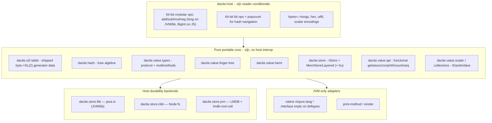

# Portable Core & Host Compatibility Layer

**Status:** DONE — Dacite's Clojure reference implementation runs unchanged on
the JVM, [babashka](https://babashka.org), and [nbb](https://github.com/babashka/nbb)
from a single `.cljc` source tree. All three hosts compute byte-for-byte
identical root hashes.

This document is the **portability contract**: the specification a future
Python / C / C++ port implements to interoperate with the Clojure reference
implementation.

---

## Goal

Run the Dacite value model on any host behind a small, explicit compatibility
layer, so that:

1. The same Clojure code runs on the JVM and on SCI hosts (babashka, nbb).
2. The boundary between "pure portable core" and "host-specific glue" is a
   single namespace (`dacite.host`) plus a handful of conventions — the exact
   surface a non-Clojure port must reimplement.
3. Every host (and every future language port) produces **identical hashes**
   for identical inputs.

Durability backends (files, LMDB, remote) are intentionally *not* portable;
the portable core ships with an in-memory store only.

---

## Architecture



Three layers:

- **Host layer** (`dacite.host`) — the *only* place platform interop lives.
- **Portable core** — plain `.cljc` built entirely on `dacite.host`; no
  `java.*`, no `js/*`, no host interop. Includes `IStore` + mem/layered/lru,
  values, **rooted stores** (`root` / `cas-root!` / `set-root!`), and
  `file-root-cell` (host fs behind reader conditionals).
- **Host durability + host adapters** — file/LMDB/remote backends, native
  collection interfaces (JVM) / cljs.core protocols (compiled CLJS; planned),
  printing. SCI loads only the backends it needs (e.g. nbb loads `store.nbb`,
  never LMDB). See [host-collection-adapters.md](host-collection-adapters.md).

---

## The host contract (`dacite.host`)

A port must provide the equivalents of these operations over a native
**unsigned 64-bit integer** ("word") type, for refs (32-byte digests, four
words), and over a **bignum** type with `mod` for fuse states (256-bit prime
field cells).

### Word representation

| Host | Word type | Notes |
|------|-----------|-------|
| JVM / babashka | native signed `long` | Modular 2^64 arithmetic *is* `unchecked-*`. Bit patterns are two's-complement. |
| nbb (ClojureScript) | `BigInt` normalized with `BigInt.asUintN(64, …)` | Same bit patterns as the JVM longs, so serialized bytes and hex match. |
| Future ports | any exact 64-bit integer | Must reproduce two's-complement bit patterns and wraparound. |

One representation per host, built or decoded (#64). The wire decoder returns
the host word the builder holds: a `hamt/bitmap` bitmap (a u32 on the wire,
the low half of a 64-bit word in the core), a hash word, a fuse cell, and the
data of a `u64` scalar, and every count and byte size (`:count` and
`:size-bytes` of a collection node and of an `ft/*` or `hamt/*` measure, each
a u64 on the wire). A `u64` scalar is stored as a host word too
(`dacite.value.types/scalar-entry`), so on nbb it realizes as a `BigInt` even
when it is small. On the JVM a u64 entry is a long word (2^64 - 1 is `-1`),
and `realize` gives its unsigned value (`types/scalar-data`,
`host/word->unsigned`): a u64 >= 2^63 realizes as a `BigInt` N, never as a
negative long. An `i64` scalar is a signed 64-bit integer, not a word: a
long on the JVM, and on nbb a signed `BigInt` (`BigInt.asIntN(64, …)`), built
(`scalar-entry`, `host/->i64`) or decoded, and on nbb it realizes as that
`BigInt` even when it is small: one representation. Code that needs a native
integer (host arithmetic, an index, a peer-v1 message field, printing) reads
it through `v/native-int` (`host/i64->native`: a Number when it is a safe
integer, |n| <= 2^53 - 1, else the `BigInt`). The EDN wire (`dacite.wire`)
writes a negative `BigInt` as signed text under `#dacite/u64` (both readers
take it); `read-edn` brings an `i64` or `u64` entry or literal body back to
the host representation (a JVM writes a small one as a plain integer, and
on the JVM a u64 entry holds the word, a u64 literal body the value).
Measures add counts with `host/add64`; code that indexes or
compares with a native integer reads a count through `host/word->long`. The
public count and size functions return the host word too: `v/count`,
`coll/coll-count`, `ft/ft-count`, `ft/ft-size-bytes`, `hamt/hamt-count`,
`hamt/hamt-size-bytes`, and `types/dacite-size` (a long on the JVM, a `BigInt`
on nbb). `v/native-count` is the count as a native integer for host
arithmetic and indexing (a Number on nbb, exact below 2^53). A u64 made from
host data is 0..2^64 - 1 (`host/max-u64`): `types/scalar-entry` checks it
(`types/check-u64`) and throws `ex-info` (`:reason :negative`, `:above-max`,
or `:not-an-integer`) on both hosts, so the public constructors, the generic
`scalar-with-store "u64"`, and literal materialization never wrap. A u64
literal body is the value, not the word (18446744073709551615N on the JVM,
never -1). Decoded wire bytes are always in range. A decoded node is `=` to the node the
library built on both hosts (`a-decoded-node-is-the-built-node`,
`npm run wire:test`); no call site coerces through `host/word` to compare. On
nbb a BigInt is slower than a Number; the speed is to come from a WASM / C++
kernel, not from a second representation.

#### Open question: measure overflow

A measure counts logical size, not stored size, so it can pass 2^64 while
storage stays tiny. Structural sharing (a shared subtree, a repeat node) lets a
small store describe a huge value: a vector of two copies of one subtree,
nested 64 deep, has a logical `:size-bytes` of at least 2^64, and in principle
`:count` can overflow the same way. Today `host/add64` wraps modulo 2^64, so
such a measure would silently be wrong. Options:

- **Throw** when a measure would pass 2^64 - 1 (the value cannot be built).
- **Saturate** at 2^64 - 1, read as "at least this big".
- **Variable-length integer** for counts and sizes in wire v2, so a measure is
  exact at any size.

Jonathan leans toward a varint in wire v2. Undecided; wire v1 is unchanged.

Practical limits today: code that indexes or compares reads a count through
`host/word->long`, which is exact below 2^63 on the JVM (a `long`) and below
2^53 on nbb (a Number). Positions at or past those bounds are not usable for
`nth`, `subvec`-style slicing, or paging, whatever the measure holds.

Bytes are represented portably as **plain integers 0..255** (vectors of ints),
never host byte arrays. This keeps the core free of `java.nio` / JS typed
arrays.

### Required operations

**Modular arithmetic (mod 2^64):** `add64`, `sub64`, `mul64`, `neg64`.

**Fuse arithmetic (mod p, p = 75509794529310452520362503714625764980405239500720831432010267419866053829067):**
`sl2-mul` (the matrix product of two states), `sl2-inverse`, `sl2-valid?`,
`sl2->bytes` / `bytes->sl2` (128 bytes), and `sl2-digest-words` (a state to
the four words of a ref). Cells are `BigInteger` on the JVM and `BigInt` on
CLJS. Reduction may be the host's `mod` or Montgomery or Barrett; the cells
returned are canonical (0..p-1).

A port that does the arithmetic outside the host language (WASM, a native
library) does not have to implement these one by one: it can provide the five
hex-in, hex-out functions of `dacite.hash/kernel` (`:state-mul`,
`:bytes->state`, `:ref->state`, `:state->ref`, `:state-valid?`), which
`fixtures/fuse-sl2/vectors.edn` `:kernel` tests exactly
(docs/design/fuse-sl2.md, "The kernel boundary").

**Bit operations:** `band64`, `bor64`, `bxor64`, `bnot64`, `shl64`,
`ushr64` (logical right shift), `popcount`.

**Coercions / helpers:** `word`, `word->int`, `->int32` (fold to signed 32-bit
for `hashCode`), `low32`, `word-zero?`, and the constants `zero-word` /
`zero-hash`.

**Byte / hex conversion:** `word->bytes` / `bytes->word` (8 big-endian bytes),
`longs->bytes` / `bytes->longs` (a hash is 4 words = 32 bytes), `byte->hex`,
`longs->hex`, `hex->longs`.

**Canonical scalar encodings (big-endian, portable byte vectors):**
`int->bytes-be` (i8..i64 / u8..u64), `f32->bytes` / `f64->bytes` (IEEE-754),
`utf8-bytes` / `utf8-decode`.

**Text (issue #16):** a string is a sequence of code points, so the host
supplies the mapping from its own string type: `cp-count`, `cp-offset`,
`cp-subs`, `chars-of`, `char-at`, `code-point-at`, `code-point->char`,
`one-char?`, and the checks `lone-surrogate-index` and `check-text!`.
`utf8-bytes` and `check-text!` throw `ex-info` `:reason :lone-surrogate` for a
lone surrogate (no host may encode it as `?` or U+FFFD); `utf8-decode` throws
`:reason :invalid-utf8` for malformed UTF-8 and keeps a leading U+FEFF. A port
whose strings are UTF-8 (Rust, Go, C) already counts bytes and decodes code
points itself; a UTF-16 port (JVM, JavaScript, C#) must count code points. The
vectors `:strings`, `:utf8`, `:invalid-utf8` and `:rejected-strings` in
`fixtures/fuse-sl2/vectors.edn` pin it (also `reference.py`). The design and the
lone-surrogate decision: `docs/design/text-code-points.md`.

**Reveal clock (does not affect root hashes):** `exp` and `log` (natural
log), `next-up` (the next IEEE-754 double, Java `Math/nextUp`; on
JavaScript the bit pattern is stepped, including at powers of two),
`finite?`, `infinite?`, `floor` (greatest integer at most `x`; a long on
the JVM), and `hash-key` (a content hash as a set element: the word vector
on the JVM, its hex on JavaScript, because a BigInt is not a persistent-set
key past eight elements). `dacite.reveal.engine` is the caller.

Get all of these exactly right and the fuse algebra, HAMT, finger-tree, and
value hashing above them are automatically identical across hosts. The
reveal clock ops are separate: they keep page order and session credit the
same across hosts, and they are not part of a hash.

---

## Byte→generator table shipped as data

The fuse is a product in SL(2, F_p) (docs/design/fuse-sl2.md). Each of the 256
byte values has a generator matrix, derived from SHA-256 seeds once and kept
only if its order is large. Rather than require a crypto primitive on every
host, the 256-entry table is **precomputed once and shipped as a Clojure data
resource** (`dacite.sl2-table/hex-table`, generated file, 128 bytes a row). The
core loads it directly.

- SHA-256 stays **JVM-only**, as a regeneration tool:
  `clojure -X:dev dacite.dev.gen-sl2-table/generate!`.
- A port either ships the same 256 hex strings verbatim, or regenerates them
  with its own SHA-256 (`fixtures/fuse-sl2/reference.py` is a Python
  re-derivation) — the values are identical either way.
- The known answers a port must reproduce are `fixtures/fuse-sl2/vectors.edn`.

This removes `MessageDigest` from the core and guarantees identical seeds
across all hosts and future language ports.

---

## The functional API (`dacite.value`)

`dacite.value` is the **canonical, cross-language surface** over Dacite
collections. On the JVM, Dacite collections *also* implement the native
`clojure.lang.*` interfaces, so plain `get`/`conj`/`nth`/`count` work; but on
SCI hosts those interfaces are unavailable, so all portable code — and any
future port — uses this API:

```
count  empty?  seq  nth  get  contains?
assoc  dissoc  conj  peek  pop  remove-nth  keys  vals
realize  type  dacite-value?  hash  get-value
```

Each takes a Dacite value first and dispatches on its `type` (`"vector"`,
`"map"`, `"set"`, `"string"`, `"blob"`). Accessors return **wrapped** Dacite
values; call `realize` to recover native content. `get-value` rehydrates a
hash from a store (used after loading a rooted-store root).

Rooted stores expose a matching portable surface (the contract a Python/C
port implements alongside the collection API):

```
root  cas-root!  set-root!  update-root!
```

```clojure
(require '[dacite.value :as v]
         '[dacite.store :as s])

(let [st (s/mem)
      xs (-> (v/vector st) (v/conj 1) (v/conj 2) (v/conj 3))]
  (v/count xs)          ; => 3
  (v/realize (v/nth xs 0)))  ; => 1
```

Host collection adapters (`clojure.lang.*` on the JVM; `cljs.core` protocols
on compiled ClojureScript) are **optional sugar** so idiomatic `count` /
`conj` / `get` work on hosts that support them. They are specified in
[host-collection-adapters.md](host-collection-adapters.md). SCI hosts
(babashka, nbb) and non-Clojure ports use the functional API only.

---

## Store protocol (`dacite.store`)

`IStore` is the portable storage interface: `s-get`, `s-put`, `s-has?`,
`s-delete`, `s-reset`. It does not list every hash, and it does not merge
a `{hash value}` map. The portable core ships
`MemStore` (atom-backed), `LayeredStore`, and `LruStore` (`dacite.store.lru`).
Durable backends live outside the pure core:

| Backend | Namespace | Hosts |
|---------|-----------|-------|
| File store | `dacite.store.file` | JVM, babashka |
| File store | `dacite.store.nbb` | nbb (Node `fs`) |
| LMDB | `dacite.store.jvm` | JVM (+ native lib) |

Rooted stores (`dacite.rooted`) are portable: the contract is `root`,
`cas-root!`, and `set-root!` (local). `file-root-cell` persists the root as
hex in `{base}/ROOT` on every host; `lmdb-root-cell` is JVM-only. Load a
committed root with `dacite.value.api/get-value`.

> **Note on map keys:** on the JVM a hash is a vector of `long`s and is used
> directly as the `MemStore` map key. On ClojureScript a hash is a vector of
> `BigInt`s, which cannot be a map key (BigInt is a primitive), so `MemStore`
> and `LruStore` key internally by the canonical hex string. Store contents are never
> compared across hosts (only root hashes are), so this internal difference is
> invisible.

---

## SCI conventions (babashka + nbb)

Writing `.cljc` that loads under SCI as well as on the JVM requires a few
rules, learned during bring-up:

- **No top-level `(do …)` that defines vars.** SCI does not splice a top-level
  `do` into separate top-level forms, so `defn`s nested in one are *not*
  promoted to namespace vars. Write each `defn` as its own top-level form with
  the host branch *inside* its body:
  ```clojure
  (defn add64 [a b]
    #?(:clj (unchecked-add (long a) (long b)) :cljs (u64 (+ a b))))
  ```
- **No `js*`.** nbb's interpreter has no compile-time `js*`. Use ClojureScript
  core fns and interop that work directly on `BigInt` (`+`, `bit-and`,
  `bit-shift-left`, `(.asUintN js/BigInt 64 x)`, …). Ensure both operands of a
  shift are `BigInt`.
- **Guard native interface impls.** `deftype` bodies implement `IDaciteValue`
  portably and fence the ~12 `clojure.lang.*` interfaces behind
  `#?@(:bb [] :clj [ … ])` (explicit empty `:bb` so babashka, which matches
  `:clj`, still skips JVM-only interfaces). `print-method` is likewise guarded.
- **Bytes are ints 0..255,** never host byte arrays, throughout the core.

---

## Running on each host

```bash
# JVM
clojure -Sdeps '{:paths ["impl/clojure/src" "examples"]}' -M -m dacite.examples.todo

# babashka (uses bb.edn)
bb todo

# nbb (uses nbb.edn; nbb installed via package.json)
npx nbb -m dacite.examples.todo
```

Portable examples live in [`impl/clojure/src/dacite/examples/`](../../impl/clojure/src/dacite/examples/):
`todo.cljc` (durable file store + rooted commit/resume) and `parity.cljc`
(canonical root hash). Todo writes under `target/dacite-todo/` by default;
pass `--reset` to wipe.

---

## Verification: cross-host hash parity

The portability guarantee is checked mechanically. `parity.cljc` builds a
canonical value and prints its 64-char root hash; `bin/hash-parity.sh` runs it
on every available host and asserts the hashes are byte-for-byte identical:

```bash
bin/hash-parity.sh
#   JVM      : b403ad76…60d7
#   babashka : b403ad76…60d7
#   nbb      : b403ad76…60d7
#   OK: identical root hash on all 3 host(s)
```

Reveal decisions and pack bytes are checked the same way.
`dacite.parity.checks` builds fixed values, runs the reveal clock, and
packs them. Given a value and a clock, the page order and the bytes are
`fixtures/parity/decisions.edn`. `bin/parity.sh` runs the root-hash check
above and then the decision suite on the JVM and on nbb. It fails if a
host fails or the digests differ. The canonical root from `parity.cljc`
is one field of that golden.

```bash
bin/parity.sh
# npm run parity:suite
# JVM alone:  cd impl/clojure && clojure -M:parity
# nbb alone:  npm run parity:test
```

The full JVM test suite (`clojure -M:dev:test`) must also stay green after any
change to the core or host layer. `dacite.parity-test` is part of that suite.

---

## Contract for future ports (Python / C / C++)

To interoperate with the Clojure reference implementation, a port must:

1. Implement the **`dacite.host` operations** over a native 64-bit integer,
   reproducing two's-complement bit patterns and mod-2^64 wraparound, and the
   fuse arithmetic over a bignum (mod p, above).
2. Ship (or regenerate) the **256-entry byte→generator table** identically.
3. Implement the **fuse algebra** (`dacite.hash`), **HAMT**, and **finger-tree**
   on top of the host ops — these are pure and translate directly.
4. Implement the canonical **scalar encodings** (big-endian ints, IEEE-754
   floats, UTF-8) and the **value hashing** rules in `dacite.value.types`.
5. Expose the **functional API** surface (`get`/`assoc`/`conj`/`nth`/`count`/
   `seq`/`get-value`/…) and an **`IStore`**-equivalent with at least an
   in-memory backend.
6. Expose the **rooted-store** surface (`root` / `cas-root!` / `set-root!`)
   over a content store + root cell. Durability backends (files, LMDB, HTTP)
   are host-specific and not part of the pure core.

If steps 1–4 match, the port's root hashes will match the reference
implementation's — which is exactly what `bin/hash-parity.sh` verifies across
JVM, babashka, and nbb today.
